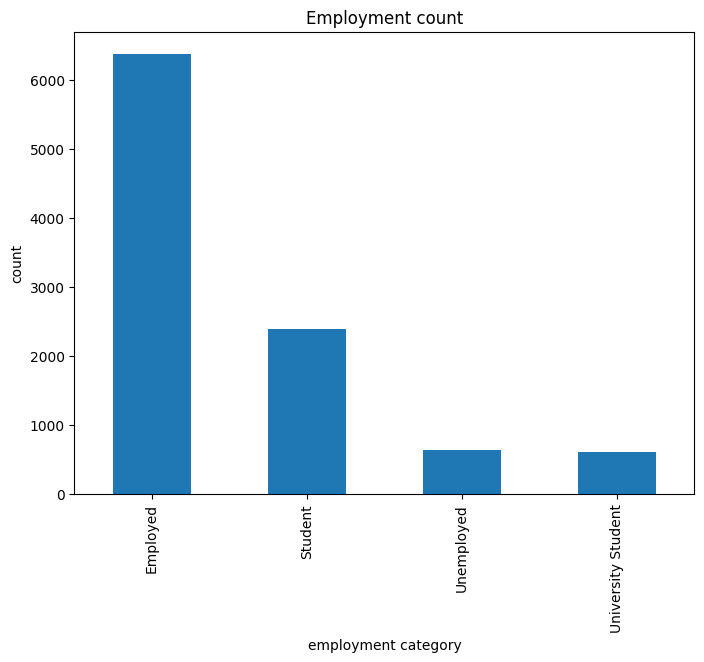
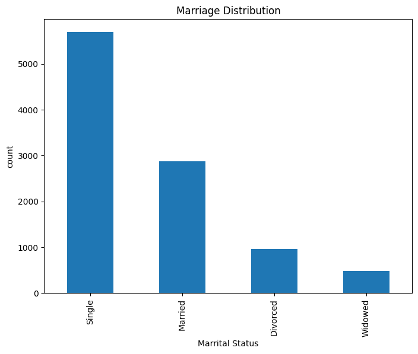
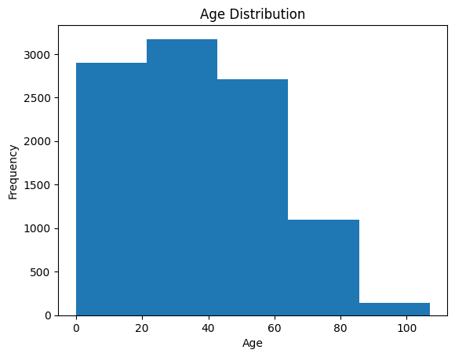
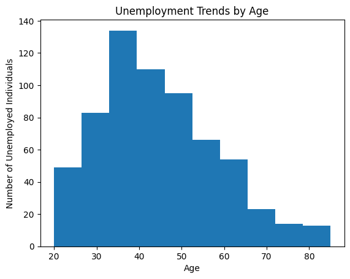

# Census Population Analysis & Community Planning

**Python · Pandas · Jupyter Notebook · Exploratory Data Analysis · Population Scenarios**

## Project overview

This project examines a community census dataset to understand population structure, employment, and household characteristics. The aim is to support evidence-informed questions about future demand for local services such as schools, healthcare and housing.

The original university coursework explored **7,758 census records** using Python. This public portfolio version provides aggregated data and a privacy-preserving notebook rather than the identifiable source records.

## Business problem

A local council needs a clearer picture of its population before making long-term infrastructure decisions. Key questions include:

- What is the age and gender composition of the community?
- How do employment and marital-status patterns vary?
- Which age groups may influence demand for schools, health services and housing?
- How might population totals change over 5, 10, 15 and 20 years under different assumptions?

## Selected visualisations

The following charts were extracted from my original Jupyter coursework. They are **static illustrations of the exploratory analysis**, not outputs generated by the privacy-preserving public notebook. The original figures should not be treated as independently validated population statistics.

### 1. Population pyramid by age and gender


Visualises the age structure for male and female records and helps identify broad demographic groups.

### 2. Employment categories



Explores the recorded employment categories. Category definitions and denominators need to be checked before using these figures as official labour-market statistics.

### 3. Marital-status distribution



Shows how the records are distributed across marital-status categories.

### 4. Age distribution



Highlights the spread of ages within the census dataset, providing context for planning services across life stages.

### 5. Unemployment by age



Illustrates how records classified as unemployed vary by age. This is a descriptive count, **not an official unemployment rate**.

> **Privacy review:** These images contain aggregate charts only, but please review every chart before publication. Do not upload the original CSV or original coursework notebook because they contain names and addresses.

## Approach and methods

1. **Data quality:** Inspected missing values, duplicate records, age anomalies and inconsistent categories.
2. **Exploratory analysis:** Examined age, gender, employment, marital status and household characteristics.
3. **Visualisation:** Used Python charts to explore demographic distributions and patterns.
4. **Scenario planning:** Added separate illustrative population-change scenarios using explicit annual growth assumptions.

## Illustrative population scenarios

The public portfolio includes a **scenario exercise**, not a trained or validated population forecast. It applies the formula:

`Population after n years = 7,758 × (1 + annual growth rate)^n`

| Years ahead | Low (−0.5% annually) | Stable (0%) | High (+0.5% annually) |
|---|---:|---:|---:|
| 0 | 7,758 | 7,758 | 7,758 |
| 5 | 7,566 | 7,758 | 7,954 |
| 10 | 7,379 | 7,758 | 8,155 |
| 15 | 7,196 | 7,758 | 8,361 |
| 20 | 7,018 | 7,758 | 8,572 |

These rates are hypothetical and **were not estimated from historical population time-series data**. Actual planning forecasts would require observed births, deaths, migration, service capacity and validation over time.

## Tools and skills

**Python, Pandas, Jupyter Notebook, data cleaning, exploratory data analysis, demographic visualisation and scenario modelling.**

## Repository contents

| File or folder | Purpose |
|---|---|
| `Census_Analysis_Public.ipynb` | Privacy-preserving analysis notebook using aggregate inputs |
| `population_by_age_gender.csv` | Aggregated population counts |
| `employment_category_summary.csv` | Aggregated employment categories |
| `marital_status_summary.csv` | Aggregated marital-status counts |
| `illustrative_population_scenarios.csv` | Hypothetical 5–20-year population scenarios |
| `images/` | Selected charts from the original coursework |
| `REPORT.md` | Detailed methods, findings and limitations |
| `DATA_DICTIONARY.md` | Definitions of public data fields |
| `requirements.txt` | Python dependencies |

## Run the public notebook

```bash
pip install -r requirements.txt
jupyter notebook Census_Analysis_Public.ipynb
```

## Limitations and confidentiality

The original individual-level dataset and notebook are not included publicly because they contain potentially identifiable names and street addresses. The public version uses aggregated records, and its illustrative population scenarios are a separate extension to the original coursework. The charts shown above are historical coursework outputs, not a validated forecasting dashboard.

## Future improvements

With longitudinal demographic and service-capacity data, this project could be extended to cohort-based forecasting, forecast evaluation, geographical comparisons and estimated infrastructure demand.
