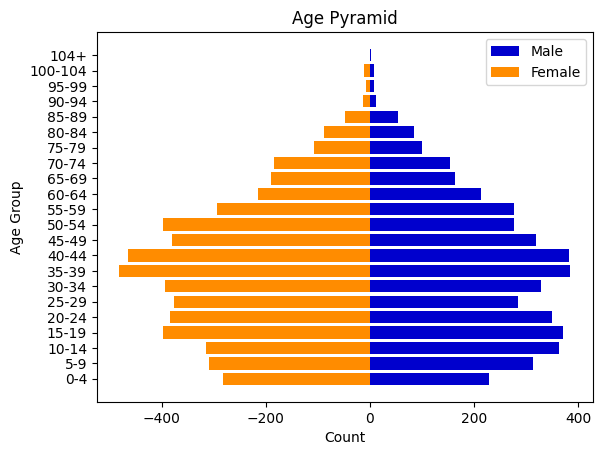

# Census Population Analysis & Infrastructure Planning

**Python · Pandas · Matplotlib · Jupyter Notebook · Exploratory Data Analysis**

A community demographic analysis developed from my MSc Artificial Intelligence and Data Science coursework at the University of Hull. The public project uses aggregated census tables to explore population structure and questions about future demand for local services.



*Selected visualisation from the original coursework. The public notebook provides an aggregate-data demonstration.*

## Business problem

Local authorities need to understand the age profile, employment characteristics and household circumstances of their communities when considering schools, healthcare, housing and other facilities.

## Business solution

Created demographic summaries and visualisations to help examine the community's population profile. The public notebook groups population by age band and compares illustrative population-change scenarios over 5, 10, 15 and 20 years.

These views provide a starting point for planning discussions alongside information about existing facilities and service capacity.

## Tools and approach

- **Python and Pandas:** read aggregate CSV tables, group records and produce population summaries.
- **Matplotlib:** visualise age-group counts and population scenarios.
- **Jupyter Notebook:** present the analysis and outputs together.
- **Scenario analysis:** compare hypothetical growth assumptions across different planning horizons.

## Key findings

From the public aggregate tables:

1. **The 35–39 age band is the largest**, followed closely by 40–44.
2. **Single is the most frequently recorded marital-status category**, followed by Married.
3. **Students and children form a substantial group**, making age-specific service needs an important planning consideration.
4. **Long-term population totals vary with the assumed growth rate**, illustrating why planning should consider more than one scenario.

## Planning recommendations

- Compare the demographic profile with existing school, healthcare and housing capacity.
- Use age-specific demand assumptions when investigating future facilities.
- Incorporate births, deaths, migration and historical population trends before developing a forecasting model.

## Explore the project

- [Open the public analysis notebook](Census_Analysis_Public.ipynb)
- [Read the project report](REPORT.md)
- [View the data dictionary](DATA_DICTIONARY.md)
- [Browse the coursework visualisations](images/)

To run the public notebook, download the repository, open a terminal in its main folder and run:

```bash
python -m pip install pandas matplotlib notebook
jupyter notebook Census_Analysis_Public.ipynb
```

## Data note

The public files contain aggregated counts rather than identifiable census records. The population scenarios use hypothetical growth assumptions; they are not validated forecasts or estimates of exact facility requirements.

---

**Oluwatobiloba Olufowobi**  
[LinkedIn](https://www.linkedin.com/in/olufowobi365/) · [GitHub](https://github.com/OlufowobiJosh)
